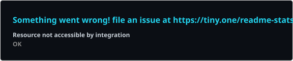

<div align="center">


**Self-taught developer. Two products in development. Zero noise.**

📍 Mumbai

[](https://dipzspell.github.io)
[](https://x.com/DipzSpell)
[](https://linkedin.com/in/dipzspell)
[](https://instagram.com/meidipanshu)

</div>

---

```text
$ whoami
> Self-taught dev. Data Science student.
> Learning by building — one project at a time.
```

---

## ⚡ Shipping

| Project | | Stack |
|---|---|---|
| 📓 **[LifeNotebook](https://lnbook.vercel.app)** | Personal Life OS. Journaling, fitness, habits, stats — one system. | React • Vite • Supabase • Capacitor |
| 📊 **TradeVision** | Real-time NSE market intelligence engine. `private` — you'll see it when it's ready. | FastAPI • Redis • Supabase • React + TS |
| 🌐 **[dipzspell.github.io](https://dipzspell.github.io)** | Portfolio. Matrix ticker rain. | HTML • CSS • JS |

---

## 🛠 Arsenal

<div align="center">


</div>

---

## 📊 Proof of Work

<div align="center">





<picture>
  <source media="(prefers-color-scheme: dark)" srcset="./profile/contributions-dark.svg" />
  <source media="(prefers-color-scheme: light)" srcset="./profile/contributions-light.svg" />
  
</picture>

</div>

---

<div align="center">

**`Work in silence. Let the commits make the noise.`**

</div>
